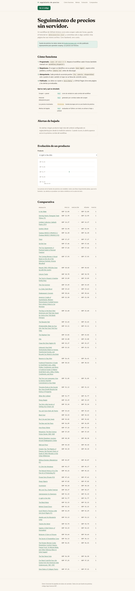
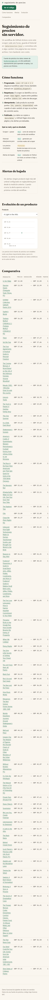

# seguimiento-de-precios

**Pipeline de seguimiento de precios 100% gratis y sin servidor.** Un workflow
de GitHub Actions corre este scraper cada 6 horas sobre
[books.toscrape.com](https://books.toscrape.com) —un sitio publicado
expresamente para practicar scraping—, guarda el historial en
`data/precios.json`, hace commit solo si algo cambió, y GitHub Pages muestra la
evolución, la comparativa y las alertas de bajada.

> English summary: a serverless price-tracking pipeline. A scheduled GitHub
> Actions workflow scrapes a practice site (books.toscrape.com) every 6 hours
> with a polite, identifiable scraper, stores history in `data/precios.json`,
> commits only on change, and GitHub Pages renders the trend chart, comparison
> table and drop alerts. MIT licensed.

## Capturas del sitio (reales)

Sitio publicado en GitHub Pages: https://esvindal.github.io/seguimiento-de-precios/




## Estructura

```
scraper/            extraer / descargar / historial / alertas / main
data/precios.json   historial por producto: [{ts, precio, disponible}]
reglas/alertas.json reglas de alerta (bajada porcentual por producto)
docs/               sitio GitHub Pages (gráfico + tabla + alertas)
docs/data/          espejo de los datos que sirve Pages
.github/workflows/  corrida programada cada 6 h
tests/              parser con HTML real guardado + historial + alertas
```

## Uso local

```bash
python -m venv .venv && .venv\Scripts\activate
pip install -r requirements-dev.txt
python -m scraper.main --paginas 3 --salida data/precios.json
```

`--espejo-docs docs/data` (activado por defecto) copia el historial y las
alertas evaluadas a la carpeta del sitio.

## Scraping respetuoso

- `User-Agent` identificable del proyecto (ver `scraper/descargar.py`).
- Espera configurable entre pedidos (`--demora`, 2 s por defecto).
- Verifica `robots.txt` antes de descargar; si lo prohibiera, aborta.
- Idempotente: solo agrega un punto al historial cuando el precio o la
  disponibilidad cambiaron.

## Qué es real y qué es simulado

| Componente | Estado |
|---|---|
| Scraper, parser, historial, alertas | **Real** — con tests |
| `data/precios.json` | **Real** — generado por corridas reales del scraper |
| Los precios mostrados | **Ficticios** — books.toscrape.com es una fuente de práctica y sus precios apenas cambian entre corridas |
| El workflow | **A verificar** — probado en sintaxis; la primera corrida real ocurre tras publicarlo |

## Limitaciones honestas

- La fuente es estática o casi: el historial crece poco y las alertas casi
  nunca se disparan. Es lo esperable en una fuente de práctica y se documenta
  en la propia página.
- Scraping de sitios reales puede violar sus Términos de Servicio: para un
  proyecto real hay que revisar ToS/robots de cada fuente (ver riesgos al pie
  del README).
- GitHub Actions gratis tiene cuota de minutos; una corrida de 3 páginas con
  demora dura < 1 min.

## Desarrollo

```bash
pytest          # parser con HTML real guardado, historial, alertas
ruff check scraper tests
mypy
```

## Riesgos legales / de plataforma

- **Scraping:** books.toscrape.com existe para practicar. Antes de apuntar a
  una tienda real, revisar sus ToS y `robots.txt`: algunos prohíben scraping.
- **GitHub Actions:** el uso programado está permitido dentro de los límites
  del plan; abusar del schedule puede suspender el repo.
- **Datos:** los precios son públicos y no hay datos personales involucrados.

Licencia MIT.
